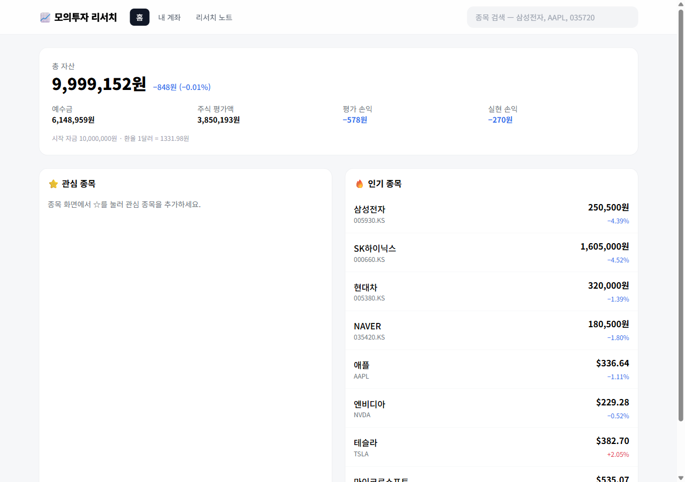
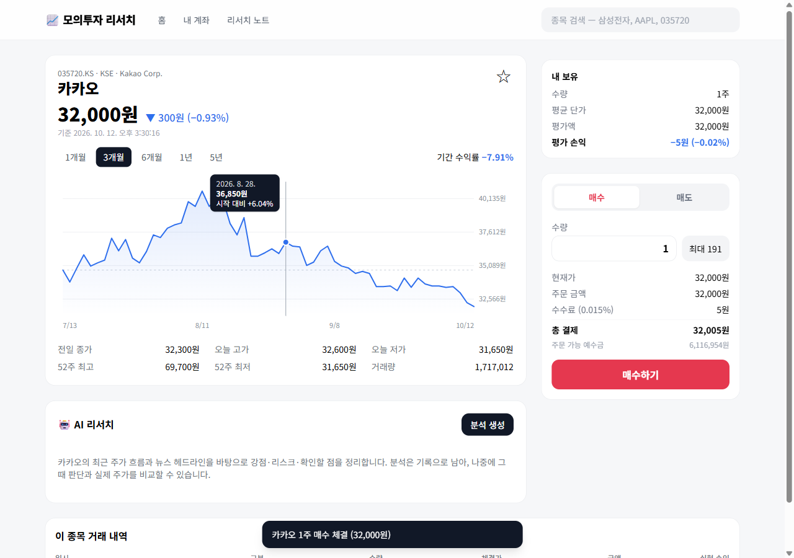

# 📈 모의투자 리서치

실제 주가(Yahoo Finance)로 가상 자금 1,000만 원을 굴려 보고, AI에게 종목 분석을 받아 기록해 두는 학습용 모의투자 앱입니다.

- 배포: https://afm-stock-sim.vercel.app
- 구성: 단일 `index.html`(CDN React 18 + Babel + Tailwind) + 단일 `server.js`(Express 5) + Supabase Postgres + OpenAI



## 기능

| 화면 | 내용 |
|---|---|
| 홈 `#/` | 총 자산·수익률·예수금·평가/실현 손익, 관심 종목, 인기 종목 시세 |
| 종목 `#/stock/:symbol` | 현재가·등락, 기간별(1개월~5년) 가격 차트 + 십자선 툴팁, 매수/매도 주문, 내 보유 현황, AI 리서치, 이 종목 거래 내역 |
| 내 계좌 `#/portfolio` | 자산 구성 막대, 보유 종목별 손익, 전체 거래 내역, 계좌 초기화 |
| 리서치 노트 `#/research` | AI 분석 기록 전체 + **분석 시점 가격 대비 현재 수익률**, 긍정/부정 판단의 방향 적중률 |

- 검색: 한글 이름(`삼성전자`, `엔비디아`), 영문 이름·티커(`nvidia`, `AAPL`), 국내 6자리 종목코드(`035720`)
- 국내(원화)·미국(달러) 종목을 거래할 수 있고, 계좌는 원화 하나입니다. 달러 종목은 체결 시점 환율로 환산합니다.
- 수수료 0.015%(매수·매도 모두). 매도 손익은 평균 단가 방식으로 계산합니다.
- 장이 닫혀 있어도 마지막 가격으로 체결됩니다(학습용 단순화).



## 로컬 실행

```powershell
cd week-6\quest\stock-sim
npm install
Copy-Item .env.example .env   # DATABASE_URL, OPENAI_API_KEY 입력
npm start                     # http://localhost:3000
```

테이블은 서버가 처음 요청을 받을 때 자동으로 만듭니다.

## DB 테이블 (접두사 `stocksim_`)

| 테이블 | 내용 |
|---|---|
| `stocksim_account` | 계좌 1행 (`id = 1`) — 예수금, 시작 자금 |
| `stocksim_holdings` | 보유 종목 — 수량, 현지 통화 평균 단가, 원화 매입 원금 |
| `stocksim_trades` | 체결 내역 — 체결가, 환율, 금액, 수수료, 실현 손익 |
| `stocksim_watchlist` | 관심 종목 |
| `stocksim_research` | AI 분석 — 분석 시점 가격, 판단(긍정/중립/부정), 보고서 JSON |

## API

| 메서드 | 경로 | 설명 |
|---|---|---|
| GET | `/api/search?q=` | 종목 검색 |
| GET | `/api/popular` | 인기 종목 시세 |
| GET | `/api/stocks/:symbol?range=` | 시세 + 차트 + 내 보유·관심 여부 |
| GET | `/api/portfolio` | 계좌 요약 + 보유 종목 평가 |
| POST | `/api/trades` | 매수/매도 `{ symbol, side, qty }` |
| GET | `/api/trades?symbol=` | 거래 내역 |
| POST | `/api/account/reset` | 계좌 초기화 |
| GET/POST/DELETE | `/api/watchlist` | 관심 종목 |
| GET/POST | `/api/research` | AI 분석 기록 조회 / 새 분석 생성 |

응답은 `{ success: true, data }` / `{ success: false, message }` 형태입니다.

## 구현하면서 해결한 문제

### 1. Yahoo Finance 시세 API가 401을 준다
흔히 쓰는 `v7/finance/quote`는 이제 crumb(쿠키 기반 토큰)이 없으면 401입니다.
키 없이 되는 **`v8/finance/chart` 응답의 `meta`**에 현재가·52주 고저·거래량·등락률이 다 들어 있어서 그것을 시세로 씁니다.
차트 요청 한 번으로 시세와 그래프를 함께 얻으므로 요청 수도 줄었습니다. `User-Agent` 헤더가 없으면 막힐 수 있어 브라우저 UA를 붙입니다.

### 2. 한글 검색이 안 된다
Yahoo 검색 API는 한글 검색어에 `Invalid Search Query`(400)를 돌려줍니다. 그래서 검색을 세 단계로 나눴습니다.
1. 서버의 **한글 별칭 표**(`삼성전자 → 005930.KS`, `엔비디아 → NVDA` 등)에서 부분 일치
2. 6자리 숫자면 국내 종목코드로 보고 **코스피(`.KS`) → 코스닥(`.KQ`)** 순으로 조회
3. ASCII 검색어일 때만 Yahoo 검색 호출

같은 표를 거꾸로 써서 화면에 `Samsung Electronics` 대신 `삼성전자`로 보여 줍니다.

### 3. 체결 가격은 서버가 정한다
브라우저가 보낸 가격으로 체결하면 개발자 도구로 싸게 살 수 있습니다. 주문 API는 **수량과 종목만 받고**,
가격·환율은 서버가 그 순간 다시 조회합니다. 확인 모달에 "체결 가격은 서버가 다시 확인합니다"라고 적어 둔 이유입니다.

### 4. 동시 주문으로 예수금을 두 번 쓰는 문제
매수 버튼을 빠르게 두 번 누르면 두 요청이 같은 잔액을 보고 둘 다 통과할 수 있습니다.
주문 전체를 트랜잭션으로 묶고 계좌 행을 `SELECT … FOR UPDATE`로 잠가 한 번에 하나씩 처리합니다.
`CHECK (cash >= 0)`, `CHECK (qty > 0)`으로 DB에서도 한 번 더 막습니다.

### 5. 원화·달러가 섞인 계좌의 손익 계산
보유 종목에 **현지 통화 평균 단가**(화면 표시용)와 **원화 매입 원금**(손익 계산용)을 따로 저장합니다.
환율이 바뀌면 같은 주가라도 원화 평가액이 달라지므로, 손익은 항상 "현재가 × 현재 환율 − 원화 원금"으로 계산합니다.
일부만 팔 때는 원화 원금을 수량 비율만큼 덜어내고 그 차액을 실현 손익으로 기록합니다.

### 6. AI가 숫자를 지어내지 않게
OpenAI에 종목 이름만 주면 실적이나 목표주가를 그럴듯하게 만들어 냅니다. 서버가 **1개월·3개월·1년 수익률, 52주 고저 대비 위치**를 직접 계산하고
최근 뉴스 헤드라인 8개와 함께 넘기며, "제공되지 않은 수치는 지어내지 말고 '확인 필요'라고 쓰라"고 지시합니다.
응답은 Structured Outputs(JSON Schema)로 받고, 그래도 개수·길이가 어긋날 수 있어 저장 전에 잘라내고 범위를 보정합니다.
분석 시점 가격을 함께 저장해 두어서, 리서치 노트에서 **AI의 판단이 이후 실제로 맞았는지** 비교할 수 있습니다.

### 7. 차트 y축 눈금이 40,135원처럼 나온다
최소~최대를 4등분하면 애매한 숫자가 나옵니다. 간격을 1·2·5 × 10ⁿ 중 가장 가까운 값으로 올려서 40,000원, 35,000원처럼 읽기 쉬운 눈금을 만듭니다.

### 8. Vercel이 만든 `.gitignore`가 `.env.example`까지 숨긴다
`vercel link`가 추가한 `.env*` 규칙이 `.env.example`도 제외해서 `!.env.example` 예외를 넣었습니다.

## 한계

- Yahoo Finance는 비공식 API라 예고 없이 막히거나 형식이 바뀔 수 있습니다. 국내 시세는 약 15~20분 지연될 수 있습니다.
- 로그인이 없어서 배포 주소를 아는 사람은 모두 같은 계좌를 씁니다.
- AI 분석은 공부용 참고 자료이며 투자 권유가 아닙니다.
